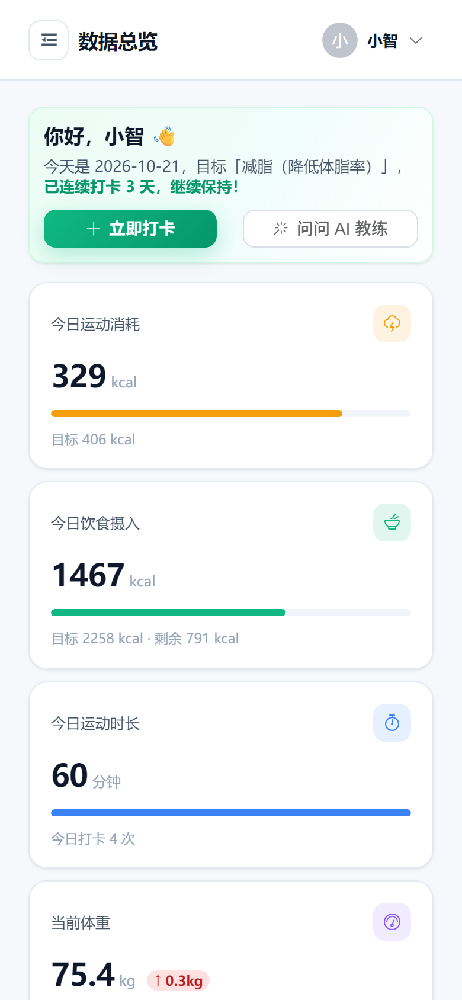
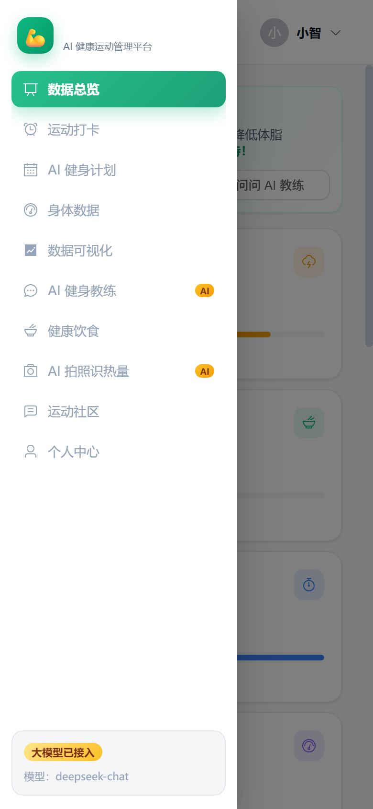
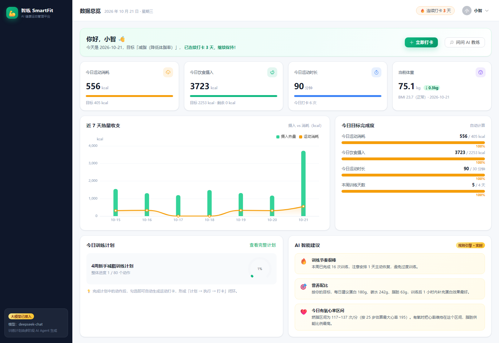
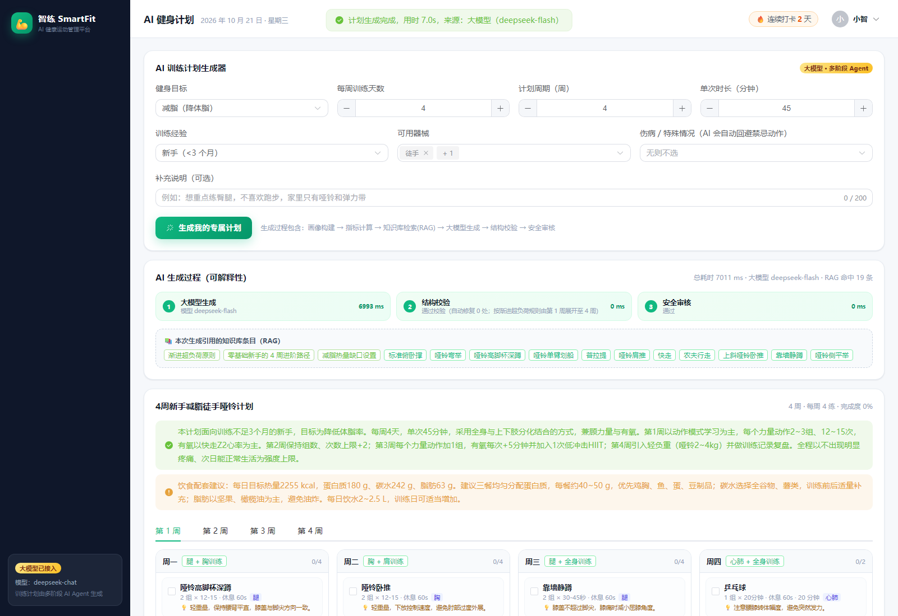
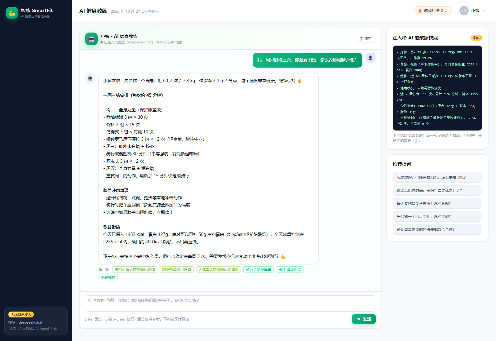
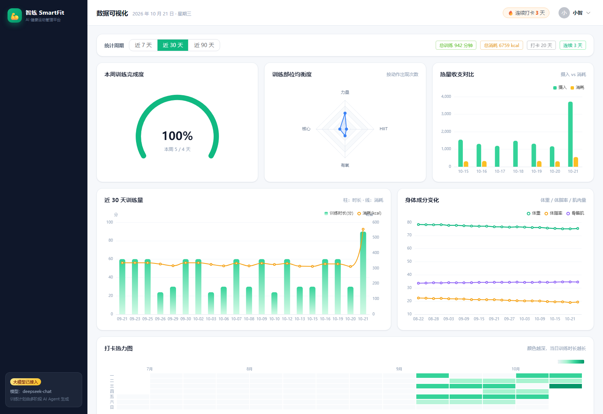
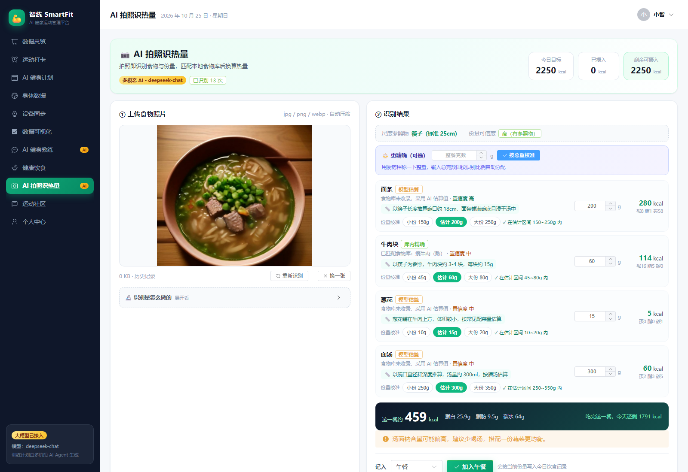
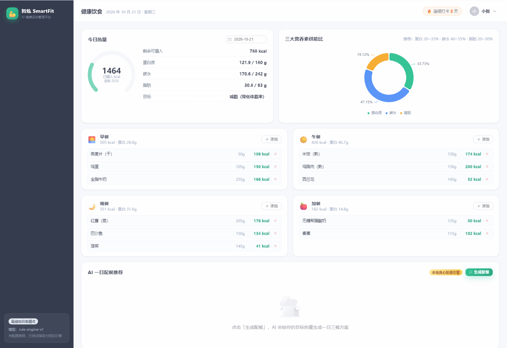
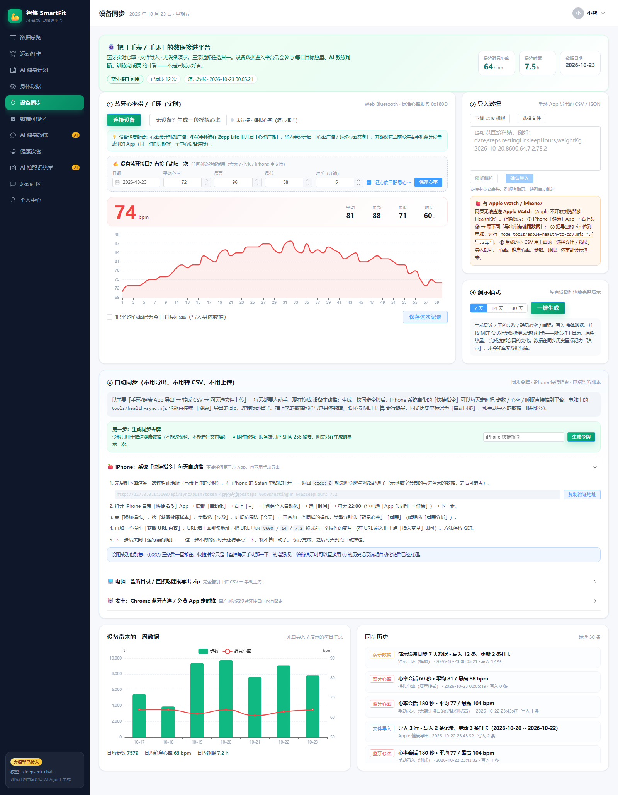
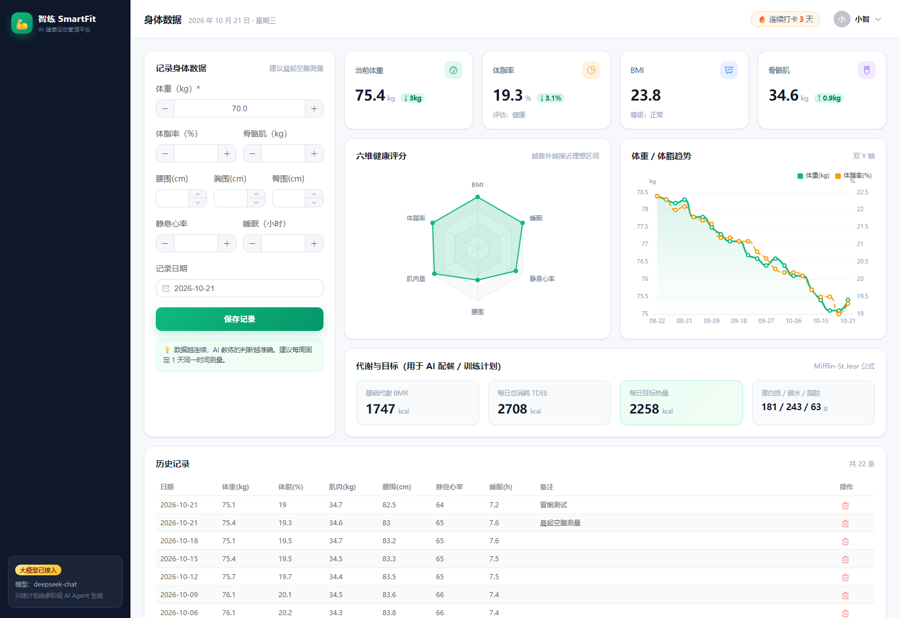

<div align="center">

# 💪 智练 SmartFit

**AI 驱动的个人健康 / 运动管理平台**

融合 **大模型 · AI Agent · RAG 检索增强 · 流式生成 · 多模态识别** 的 AI 原生 Web 应用

[](https://vuejs.org/)
[](https://vitejs.dev/)
[](https://element-plus.org/)
[](https://echarts.apache.org/)
[](https://nodejs.org/)
[](https://expressjs.com/)
[](#-开源协议)

**2026 第九届传智杯全国大学生数智创新与 AI 应用大赛 · AI WEB 网页开发挑战赛 参赛作品**

### 🌐 在线演示（永久地址，手机 4G 可直接打开）

**https://smartfit-qsyh.onrender.com**　👤 演示账号 `demo` / 密码 `123456`

> 部署在 Render 免费实例上，域名固定不变；15 分钟无人访问会休眠，**首次打开需等 30~60 秒**（唤醒中，不是坏了）。
> 自己本地跑也只要三步，见下方 [安装运行指南](#-安装运行指南)。

</div>

---

## 📖 项目介绍

### 解决什么问题

《"健康中国 2030"规划纲要》把全民健身上升为国家战略，但大众健身普遍卡在三个地方：

| 痛点 | 表现 | 智练 SmartFit 的回应 |
| --- | --- | --- |
| **不知道怎么练** | 网上的计划千篇一律，不适合自己的体重、器械和伤病 | AI 根据身体数据 + 目标 + 器械 + 伤病，生成专属 4~12 周分化训练计划 |
| **练了看不到效果** | 只记体重，看不出体脂、围度、热量收支的变化 | 6 类可视化图表 + 六维健康雷达 + 代谢指标，变化一眼可见 |
| **坚持不下去** | 独自训练缺乏反馈与陪伴 | 计划勾选 → 自动打卡 → 一键分享到社区 → 排行榜激励的闭环 |

### 产品定位

> **一个把「AI 健身教练」做成可解释、可校验、可降级工程流水线的个人健康管理平台。**

它不是一个"套壳 AI 聊天页"，而是让 AI 深度嵌入业务流程：

- **AI 生成的计划能落库、能勾选、能统计进度**（结构化输出 + 校验 + 入库）
- **AI 的每一步决策都可解释**（前端展示画像 → 检索 → 生成 → 校验 → 安全审核的完整时间线）
- **AI 不可用时产品依然完整**（三层降级：大模型 → 修复重试 → 本地规则引擎 / 检索式问答）

### 九大功能模块

| 模块 | 能力 | AI 参与 |
| --- | --- | --- |
| 🏃 **运动打卡** | 动作库搜索打卡、组数/次数/时长/强度、体温感受、日历热力图、连续打卡天数 | 无（MET 公式确定性计量） |
| 🤖 **AI 健身计划** | 输入身体情况 → 生成周计划；勾选完成可自动生成打卡 | ⭐ 核心（Agent 编排 + RAG + 校验） |
| 📏 **身体数据** | 体重/体脂/肌肉/围度/静息心率/睡眠录入、BMI 与体脂评估、代谢指标 | 间接（作为 AI 上下文） |
| ⌚ **设备同步** | 五条通路把可穿戴数据接进来：**蓝牙心率带实时心率**（Web Bluetooth 标准 GATT 0x180D，含实时曲线与统计）/ **手动录入一次心率**（任何浏览器都能用：夸克、小米浏览器、iPhone 皆可）/ **手环 App 导出的 CSV·JSON**（先预览再写库，支持中英文表头）/ **Apple Watch 走「健康」App 导出**（`node tools/apple-health-to-csv.mjs 导出.zip` 本地转 CSV 再导入）/ **无设备演示模式**；此外还有 **🔁 自动同步**：生成同步令牌后，iPhone 系统「快捷指令」每天定时把步数/心率/睡眠推到平台，电脑端 `tools/health-sync.mjs` 可直接监听目录或吃「健康」导出 zip（不用再转 CSV、不用手动上传），见 [`docs/健康数据自动同步.md`](docs/健康数据自动同步.md)；步数按 MET 折算成步行打卡、静息心率与睡眠写入身体数据 | 无（标准蓝牙协议 + 确定性换算） |
| 📊 **数据可视化** | 热量收支、训练量、部位均衡度、身体成分、打卡热力图、目标仪表盘 | 无（数据聚合） |
| 💬 **AI 健身教练** | 多轮对话、逐字流式输出、引用知识库来源、展示注入的用户数据快照 | ⭐ 核心（SSE + RAG） |
| 🥗 **健康饮食** | 食物库检索、四餐记录、三大营养素供能比、AI 一日配餐一键采纳 | ⭐ 较强（大模型 + 食物库约束） |
| 📷 **AI 拍照识热量** | 上传/拍照 → 多模态识别食物种类 → **重量估算（参照物推理 + 份量区间）** → **厨房秤称重后输入整餐总重一步精确校准**（也可只称一种食材按比例推算） → 匹配食物库换算热量 → 结合身体条件给饮食建议 → 一键记入饮食；含识别历史与数据来源标注 | ⭐ 核心（多模态视觉 + 双源校验 + 尺度推理 + 餐食评估 Agent） |
| 👥 **运动社区** | 图文发帖、话题、关联打卡、点赞评论、时间衰减热度排序、周榜 | 无（热度算法） |

### 响应式：同一套代码适配手机

- **≤900px**：侧边导航折叠为抽屉（顶栏汉堡按钮唤出），多栏卡片降为单栏，图表高度自适应
- **≤600px**：字号/内边距/弹窗宽度进一步收紧，发帖栏与表单控件纵向堆叠
- 手机与电脑在同一 Wi-Fi 下，可用 `http://<电脑IP>:5173` 访问（`npm run dev` 启动日志会直接打印该地址）
- 移动端已逐页体检：**11 个页面全部通过、零横向溢出**（`node tools/audit-pages.mjs --mobile`）

| 手机 · 数据总览 | 手机 · 抽屉导航 | 手机 · AI 拍照识热量 |
| --- | --- | --- |
|  |  |  |

### 手机怎么打开（三种方式，按需选）

| 方式 | 地址 | 适用 | 注意 |
| --- | --- | --- | --- |
| **同一个 Wi-Fi** | `http://<电脑IP>:3000`（生产）或 `:5173`（开发） | 电脑和手机连同一个路由器 | 地址固定不变，最快最稳；`npm run dev` 会直接打印这个地址 |
| **扫码打开** | 双击桌面「**手机扫码打开智练**」 | 不想在手机上敲长网址 | 页面会把当前地址渲染成二维码，手机相机扫屏幕即可；每 10 秒自动刷新，隧道换域名后自动跟着变 |
| **公网穿透** | `node tools/tunnel.mjs` 打印的 https 地址 | 手机用 4G、和电脑不在同一网络 | 免费隧道会定期断开，**域名会变**；地址同步写入 `tools/tunnel-url.txt`，脚本会自动重连并切换线路（localhost.run → pinggy） |

> 手机打开后如果只看到一行 **`no tunnel`**，说明这条公网地址已经过期（隧道重连换了域名），
> 回到电脑看扫码页或 `tools/tunnel-url.txt` 里的新地址即可；同 Wi-Fi 那条地址则永远不会失效。
>
> **想发给别人一个永久不变的网址？** 免费隧道的域名按设计会定期变化（防止钓鱼），
> 要固定地址只能把应用部署到云平台——仓库已备好 `Dockerfile` + `render.yaml`，
> 步骤见 [`docs/部署到云-永久地址.md`](docs/部署到云-永久地址.md)（Render 免费套餐即可，约 5 分钟）。

### 界面预览

| 数据总览 | AI 健身计划 |
| --- | --- |
|  |  |

| AI 健身教练 | 数据可视化 |
| --- | --- |
|  |  |

| AI 拍照识热量（多模态） | 健康饮食 |
| --- | --- |
|  |  |

| 设备同步（可穿戴） | 身体数据 |
| --- | --- |
|  |  |

> 更多界面截图见 [`docs/screenshots/`](docs/screenshots/)，完整技术方案见 [`docs/智练SmartFit-技术文档.pdf`](docs/智练SmartFit-技术文档.pdf)。

---

## 🏗️ 技术架构

### 总体架构

```
┌──────────────────────────────────────────────────────────────┐
│  表现层   Vue 3 + Vite + Vue Router + Pinia + Element Plus + ECharts │
└───────────────────────────┬──────────────────────────────────┘
                            │ HTTP/JSON  +  SSE（AI 流式）
┌───────────────────────────▼──────────────────────────────────┐
│  接口层   Express Router（auth / body / checkin / plan / diet /  │
│           community / dashboard / ai）                          │
├──────────────────────────────────────────────────────────────┤
│  AI 能力层  Profile Builder │ Plan Agent(6 阶段) │ Coach Agent  │
│            Diet Agent │ BM25+混合检索 │ 输出校验 │ 安全审核 │     │
│            语义缓存 │ 可观测性 │ 本地规则引擎（降级）             │
├──────────────────────────────────────────────────────────────┤
│  领域服务层  健康公式(MET/BMR/TDEE) │ 计划业务 │ 营养换算 │ 热度分 │
├──────────────────────────────────────────────────────────────┤
│  数据层   SQLite（node:sqlite 内置）· 14 张表 · 种子数据          │
├──────────────────────────────────────────────────────────────┤
│  外部能力  大模型（OpenAI 兼容协议，可选）· 视觉模型（可选）        │
└──────────────────────────────────────────────────────────────┘
```

### 技术栈与选型理由

| 层次 | 技术 | 版本 | 选型理由 |
| --- | --- | --- | --- |
| 前端框架 | Vue 3（Composition API） | ^3.5.13 | 逻辑按功能聚合，`<script setup>` 代码量更少；响应式天然适配图表联动 |
| 构建工具 | Vite | ^6.0.7 | 冷启动与 HMR 极快，产物按需拆包 |
| UI 组件库 | Element Plus | ^2.9.1 | Vue 3 生态最完整的中后台组件库，自带中文语言包 |
| 图表 | ECharts | ^5.5.1 | 覆盖折线/柱状/饼/雷达/仪表盘/日历热力图全部需求 |
| 状态管理 | Pinia | ^2.3.0 | Vue 官方推荐，比 Vuex 更简洁 |
| 后端框架 | Express | ^4.21.2 | 中间件模型清晰，便于鉴权/日志/错误处理分层 |
| 数据库 | SQLite（`node:sqlite`） | Node 内置 | **零安装、单文件**，评审克隆后无需配置数据库即可运行 |
| 参数校验 | Zod | ^3.24.1 | 声明式 schema，错误信息可直接面向用户 |
| 鉴权 | JWT + bcryptjs | ^9.0 / ^2.4 | 无状态、可水平扩展；bcrypt 自带盐值 |
| 大模型 | OpenAI 兼容协议 | — | 供应商无关（DeepSeek/通义/Moonshot/本地模型均可） |

### AI 技术方案（核心亮点）

**训练计划生成 = 六阶段 Agent 流水线**

```
① 画像构建 → ② 指标计算 → ③ RAG 检索 → ④ 大模型生成 → ⑤ 结构校验 → ⑥ 安全审核
                （确定性代码）    （BM25+混合）   （JSON 模式）    （防幻觉）     （禁忌剔除）
                                          ✗ 任一阶段失败 → ⑦ 本地规则引擎降级
```

| 关键技术 | 作用 |
| --- | --- |
| **算术外移** | BMR/TDEE/目标热量/营养素由代码算好写进提示词并声明"不得修改"，消除数值幻觉 |
| **RAG（BM25 + 结构化过滤 + MMR）** | 中文单字+bigram 分词自实现 BM25，叠加器械/难度/伤病过滤、标签加权、去冗余 |
| **查询扩展** | 18 组口语→知识库用词映射（"膝盖疼"→"膝关节/低冲击/替代动作"） |
| **结构化输出校验** | 容错解析 → 字段归一化 → 动作白名单比对 → 数值夹取 → 周次补全 |
| **安全审核 Guardrail** | 伤病/慢病 → 禁忌动作映射为纯规则代码，独立于模型，结论对用户可见 |
| **多模态识别** | 拍照 → 视觉模型识别食材与份量 → 名称包含 + BM25 + 二元组重叠 + 泛化词剔除对齐食物库 → 按库值重算热量，库值与估算差 3 倍则判误匹配弃用（实测 8 种食材全匹配、2~3 秒；回归用例见 `tools/test-food-match.mjs`） |
| **SSE 流式输出** | 教练对话逐字推送，首字延迟从数秒降至 <1.5s |
| **语义缓存** | 画像指纹 + LRU + TTL，重复生成毫秒级返回 |
| **输出长度控制** | 计划只让模型生成「第 1 周模板 + 递进说明」，其余周次由规则按渐进超负荷展开——实测把「19s 且降级」变成「7.2s 且一次通过」 |
| **数值兜底校正** | 配餐与目标热量偏差超 ±8% 时，按比例自动缩放每份克数并重算营养值（实测 −39% → −0.4%） |
| **三层降级** | 大模型 → 修复重试 → 规则引擎 / 检索式问答，**无 API Key 也能完整演示** |
| **可观测性** | `ai_call_logs` 记录场景/耗时/缓存/降级/重试/RAG 命中，前端统计面板可查 |

> 详细设计（选型对比、集成方式、优化策略、创新点）见技术文档 **第四章** 与 **第七章**。

---

## 🚀 安装运行指南

### 环境要求

| 依赖 | 版本要求 | 说明 |
| --- | --- | --- |
| Node.js | **≥ 22.5.0**（推荐 22 LTS / 24） | 必须，因为使用了内置 `node:sqlite` 模块 |
| npm | ≥ 9 | 随 Node 安装 |
| 浏览器 | Chrome / Edge / Firefox 最新版 | 需支持 ES2020+ 与 `ReadableStream` |
| 数据库 | **无需安装** | SQLite 随 Node 内置，数据文件自动生成 |
| 大模型 API Key | **可选** | 不配置时自动进入"离线知识库模式"，功能完整可用 |

### 方式一：双击启动（最简单，适合本机演示）

Windows 用户直接双击项目根目录下的：

```
启动智练SmartFit.bat
```

它会自动完成「检查依赖 → 检查/初始化数据库 → 启动前后端 → 打开浏览器」，
启动后浏览器会自动访问 **http://127.0.0.1:5173**，用 `demo / 123456` 登录即可。

> · 会弹出一个命令行窗口，**不要关闭它**（关闭 = 停止服务）
> · 启动过程与错误信息记录在 `logs\launcher.log`，出问题可直接查看
> · 因为这是「前端 + 后端」的完整应用，**不存在可以双击直接打开的 html 文件**；
>   双击 `web/index.html` 会白屏（Vue 单页应用必须经服务器编译并访问后端接口）
> · 如果浏览器没有自动弹出，手动在地址栏输入 `http://127.0.0.1:5173`
>   （用 `127.0.0.1` 而不是 `localhost`，可避开 Windows 上 IPv6 解析问题）

### 方式二：命令行启动（macOS / Linux / 需要热更新调试时）

```bash
# 1. 安装依赖（npm workspaces，一次装完前后端）
npm install

# 2. 初始化数据库（建表 + 导入知识库 + 生成演示数据）
npm run init:db

# 3. 启动开发环境（后端 :3000 + 前端 :5173 同时启动）
npm run dev
```

启动后访问 **http://localhost:5173**，用演示账号登录：

| 账号 | 密码 | 说明 |
| --- | --- | --- |
| `demo` | `123456` | 主演示账号（60 天身体数据 / 30 天打卡 / 4 周 AI 计划 / 14 天饮食 / 社区内容） |
| `lily` · `coach` · `runner` | `123456` | 社区互动账号，可登录后互相点赞评论 |

> 也可以直接 `npm run dev:web` 或 `npm run dev:server` 单独启动某一端。

### 生产部署（单进程同源）

```bash
npm run build     # 构建前端到 web/dist
npm start         # 后端启动并托管前端产物
# 访问 http://localhost:3000
```

后端会对非 `/api`、`/uploads` 的 GET 请求回落 `index.html`，以支持前端 history 路由，因此**单端口即可完成部署**，无需 Nginx。

### 常用命令

| 命令 | 作用 |
| --- | --- |
| `npm run init:db` | 初始化数据库（已有数据则跳过，幂等） |
| `npm run reset:db` | 清空并重建演示数据（演示前重置用） |
| `npm run dev` | 同时启动前后端开发服务 |
| `npm run dev:server` | 仅启动后端（`node --watch` 热重载） |
| `npm run dev:web` | 仅启动前端 |
| `npm run build` | 构建前端生产包 |
| `npm start` | 以生产模式启动（后端托管前端） |

---

## ⚙️ 环境配置说明

### 1. 环境变量模板

复制模板并按需修改（**所有变量都有默认值，不配置也能启动**）：

```bash
# Windows
copy .env.example server\.env
# macOS / Linux
cp .env.example server/.env
```

| 变量 | 默认值 | 说明 |
| --- | --- | --- |
| `PORT` | `3000` | 后端监听端口 |
| `NODE_ENV` | `development` | `development` / `production` |
| `JWT_SECRET` | `smartfit-dev-secret-...` | **生产环境务必替换为随机长字符串** |
| `JWT_EXPIRES_IN` | `7d` | 登录态有效期 |
| `DB_FILE` | `data/smartfit.db` | SQLite 文件路径（相对 `server/`） |
| `AI_API_KEY` | 空 | **留空即进入离线知识库模式**（功能仍完整） |
| `AI_BASE_URL` | `https://api.deepseek.com/v1` | OpenAI 兼容接口地址 |
| `AI_MODEL` | `deepseek-chat` | 文本模型名 |
| `AI_VISION_MODEL` | 空 | 配置后开放"拍照识别食物"多模态能力 |
| `AI_TIMEOUT_MS` | `45000` | 单次请求超时（毫秒） |
| `AI_TEMPERATURE` | `0.6` | 采样温度 |
| `RAG_TOP_K` | `6` | 知识库检索返回条数 |
| `AI_CACHE_ENABLED` | `true` | 语义缓存开关 |
| `AI_RATE_LIMIT_PER_MIN` | `20` | AI 接口每用户每分钟上限 |
| `VITE_API_BASE` | 空 | 前端请求后端地址（留空走 Vite 代理） |

### 2. 接入真实大模型（可选）

```ini
# server/.env
AI_API_KEY=sk-你的密钥
AI_BASE_URL=https://api.deepseek.com/v1   # 通义: https://dashscope.aliyuncs.com/compatible-mode/v1
AI_MODEL=deepseek-chat                    # 通义: qwen-plus ； Moonshot: moonshot-v1-8k
```

**无需改动任何代码**：重启后端后，侧边栏状态会变为「大模型已接入」，训练计划将走完整六阶段 Agent 流水线。
不配置密钥时，系统自动使用本地规则引擎生成同结构计划、用 RAG 检索式问答代替对话，界面会诚实标注当前模式。

### 3. 依赖清单

<details>
<summary><b>后端依赖</b>（<code>server/package.json</code>）</summary>

| 依赖 | 版本 | 用途 |
| --- | --- | --- |
| express | ^4.21.2 | HTTP 框架与中间件 |
| cors | ^2.8.5 | 开发期跨域 |
| jsonwebtoken | ^9.0.2 | JWT 签发与校验 |
| bcryptjs | ^2.4.3 | 密码加盐哈希（纯 JS，无编译） |
| zod | ^3.24.1 | 请求参数校验 |
| node:sqlite | Node 内置 | 数据库驱动（零依赖） |

</details>

<details>
<summary><b>前端依赖</b>（<code>web/package.json</code>）</summary>

| 依赖 | 版本 | 用途 |
| --- | --- | --- |
| vue | ^3.5.13 | 核心框架 |
| vue-router | ^4.5.0 | 路由与登录守卫 |
| pinia | ^2.3.0 | 状态管理 |
| element-plus | ^2.9.1 | UI 组件库 |
| @element-plus/icons-vue | ^2.3.1 | 图标 |
| echarts | ^5.5.1 | 图表 |
| axios | ^1.7.9 | HTTP 客户端 |
| vite | ^6.0.7 | 构建工具（dev） |
| @vitejs/plugin-vue | ^5.2.1 | Vue 插件（dev） |

</details>

<details>
<summary><b>根依赖</b>（<code>package.json</code>）</summary>

| 依赖 | 版本 | 用途 |
| --- | --- | --- |
| concurrently | ^9.1.0 | 一条命令同时启动前后端 |

</details>

---

## 📂 代码结构

```
传智杯/
├── package.json                    # npm workspaces 根配置
├── .env.example                    # 环境变量模板
├── .gitignore
├── README.md                       # 本文件
│
├── server/                         # ═══ 后端 ═══
│   ├── package.json
│   ├── data/
│   │   ├── kb/exercises.json       # 动作知识库 65 条（含 MET、禁忌）
│   │   ├── kb/foods.json           # 食物营养库 76 条（每 100g）
│   │   └── kb/guidelines.json      # 训练/营养指南 25 篇
│   ├── scripts/smoke-test.mjs      # 接口冒烟测试脚本
│   └── src/
│       ├── index.js                # 服务入口（初始化 DB → 启动 HTTP）
│       ├── app.js                  # Express 装配（中间件顺序、路由挂载、静态托管）
│       ├── config/index.js         # 配置中心（.env 解析 + 默认值 + 启动摘要）
│       ├── db/
│       │   ├── schema.sql          # 15 张表的 DDL（含中文注释）
│       │   ├── index.js            # 连接与 get/all/run/tx 封装
│       │   └── seed.js             # 知识库导入 + 演示数据生成
│       ├── middleware/             # auth（JWT 鉴权）/ syncAuth（同步令牌鉴权）/ error（统一错误）/ common（日志·限流）
│       ├── utils/                  # health（健康公式）/ security（密码·JWT）/ syncToken（令牌生成与摘要）/ response
│       ├── modules/                # 业务模块
│       │   ├── auth/               # 注册/登录/档案
│       │   ├── body/               # 身体数据 + 六维分析
│       │   ├── checkin/            # 打卡 + 统计（热力图/连续天数）
│       │   ├── exercise/           # 动作库检索
│       │   ├── plan/               # 计划路由 + service（持久化与进度）
│       │   ├── diet/               # 食物库/记录/AI 配餐
│       │   ├── community/          # 帖子/点赞/评论/排行榜
│       │   ├── dashboard/          # 首页聚合
│       │   ├── foodscan/           # 拍照识热量（多模态识别的业务落库与历史）
│       │   ├── devices/            # 设备同步（蓝牙心率 / CSV·JSON 导入 / 演示模式）+ service（解析与写库，供导入和自动同步共用）
│       │   ├── sync/               # 自动同步（令牌签发 + 令牌鉴权推送，免导出免上传）
│       │   └── ai/                 # AI 能力路由（status/stats/coach SSE/upload/vision）
│       └── ai/                     # ★ AI 能力层
│           ├── provider.js         # OpenAI 兼容客户端（超时/重试/流式/多模态）
│           ├── prompts.js          # 提示词工程
│           ├── rag.js              # BM25 索引 + 混合检索 + MMR + 查询扩展
│           ├── validators.js       # 结构化输出容错解析与校验
│           ├── profile.js          # 用户画像 + 安全过滤规则
│           ├── planAgent.js        # 训练计划六阶段编排
│           ├── coachAgent.js       # 教练对话（SSE + 检索式降级）
│           ├── dietAgent.js        # 饮食配餐 + 热量对齐校验
│           ├── fallback.js         # 本地规则引擎（降级方案）
│           ├── cache.js            # LRU + TTL 语义缓存
│           └── observability.js    # AI 调用日志与统计
│
├── web/                            # ═══ 前端 ═══
│   ├── package.json
│   ├── vite.config.js              # 代理 /api → :3000；手动拆包优化
│   ├── index.html
│   └── src/
│       ├── main.js                 # 入口（Element Plus 中文包 + 图标全局注册）
│       ├── App.vue
│       ├── api/index.js            # Axios 封装（拦截器）+ SSE 流式客户端
│       ├── stores/user.js          # Pinia 用户态
│       ├── router/index.js         # 路由 + 登录守卫 + 标题
│       ├── styles/index.css        # 设计令牌（CSS 变量）与全局样式
│       ├── utils/date.js           # 轻量日期工具
│       ├── layouts/MainLayout.vue  # 侧边导航 + 顶栏 + AI 状态面板
│       ├── components/
│       │   ├── ChartBox.vue        # ECharts 通用封装（resize/dispose/空态）
│       │   └── StatCard.vue        # 指标卡
│       └── views/                  # 11 个页面
│           ├── Login.vue           # 登录/注册
│           ├── Dashboard.vue       # 数据总览
│           ├── Checkin.vue         # 运动打卡
│           ├── Plan.vue            # AI 健身计划
│           ├── Body.vue            # 身体数据
│           ├── Devices.vue         # 设备同步（蓝牙心率 / 导入 / 演示 / 自动同步令牌）
│           ├── Analytics.vue       # 数据可视化
│           ├── Coach.vue           # AI 健身教练
│           ├── Diet.vue            # 健康饮食
│           ├── Community.vue       # 运动社区
│           └── Profile.vue         # 个人中心 + AI 运行统计
│
├── tools/                          # ═══ 本地工具（不参与线上运行） ═══
│   ├── health-sync.mjs             # 健康数据自动同步客户端（--once 推文件 / --watch 监听目录）
│   ├── lib/apple-health.mjs        # Apple「健康」导出解析（zip 流式解压 + 按天聚合）
│   ├── apple-health-to-csv.mjs     # 导出 → CSV（手动导入用，与上面共用解析逻辑）
│   ├── test-devices.mjs            # 设备同步自测（含自动同步令牌全流程）
│   ├── audit-pages.mjs             # 11 页功能与移动端布局体检
│   └── verify-online.mjs           # 线上地址完整验收
│
└── docs/
    ├── 智练SmartFit-技术文档.pdf    # 技术文档（30 页以内）
    ├── 技术文档.html               # 技术文档源文件（可编辑后重新导出 PDF）
    └── screenshots/                # 界面截图（桌面 + mobile/ 手机端）
```

**分层原则**：路由层（`modules/*/routes.js`）只做参数校验与响应封装；领域逻辑放在 `service` 或 `utils`；AI 能力集中在 `src/ai/`，与业务解耦，可单独替换。
所有源码均带中文注释（64 个源码文件、17247 行、注释率 12.8%，可用 `node tools/count-code.mjs` 复算），关键算法处注明"为什么这么做"，便于阅读与二次开发。

---

## 📡 接口概览

统一响应体：`{ code, message, data }`，`code = 0` 表示成功。

<details>
<summary><b>展开完整接口清单</b></summary>

| 方法 | 路径 | 说明 |
| --- | --- | --- |
| POST | `/api/auth/register` · `/api/auth/login` | 注册（自动登录）· 登录返回 JWT |
| GET / PUT | `/api/auth/me` · `/api/auth/profile` | 当前用户 · 更新档案 |
| GET / POST | `/api/body/records` | 身体数据列表 / 新增 |
| DELETE | `/api/body/records/:id` | 删除记录 |
| GET | `/api/body/analysis` | BMI、体脂评估、六维雷达、代谢指标、趋势 |
| GET | `/api/exercises` · `/api/exercises/meta` | 动作库检索 / 筛选项 |
| GET / POST | `/api/checkin/logs` | 打卡记录 / 新增（服务端按 MET 算热量） |
| DELETE | `/api/checkin/logs/:id` | 删除打卡 |
| GET | `/api/checkin/stats` | 热力图 / 连续天数 / 本周汇总 / 分类占比 |
| POST | `/api/plan/generate` | **AI 生成训练计划**（返回计划 + 元信息 + RAG 引用 + 审核报告） |
| GET | `/api/plan/list` · `/api/plan/:id` · `/api/plan/latest/practice` | 列表 / 详情 / 今日待练 |
| PATCH | `/api/plan/items/:id` | 勾选动作（`autoCheckin` 可自动生成打卡） |
| DELETE | `/api/plan/:id` | 删除计划 |
| GET | `/api/diet/foods` · `/api/diet/summary` | 食物库 / 某日饮食汇总 |
| POST | `/api/diet/logs` · `/api/diet/logs/batch` | 记录一条 / 批量采纳 |
| POST | `/api/diet/recommend` | **AI 一日配餐**（含热量对齐偏差校验） |
| GET / POST | `/api/community/posts` | 信息流（热门/最新/话题）/ 发帖 |
| POST | `/api/community/posts/:id/like` · `/comments` | 点赞切换 / 评论 |
| GET | `/api/community/leaderboard` | 本周打卡排行榜 |
| GET | `/api/food-scan/capability` | 视觉模型能力探测 + 今日剩余热量额度 |
| POST | `/api/food-scan/analyze` | **多模态拍照识热量**：图片 → 食物清单 + 份量 + 热量（含库匹配与双源校验） |
| GET | `/api/food-scan/history` · `/:id` | 识别历史 / 单条详情 |
| POST | `/api/food-scan/:id/log` | 把识别结果按当前份量记入指定餐次 |
| POST | `/api/food-scan/advice` | **份量试算 + 个性化饮食建议**：规则层判定占比/蛋白/脂肪，大模型生成点评 |
| DELETE | `/api/food-scan/:id` | 删除识别记录 |
| GET | `/api/devices/status` · `/api/devices/history` | 设备同步概览（同步次数 / 最近一次 / 今日静息心率）/ 同步历史 |
| GET | `/api/devices/daily` | 设备每日数据（步数 / 静息心率 / 睡眠，供一周图表） |
| POST | `/api/devices/heart-rate` | **蓝牙心率会话落库**（可同时写入今日静息心率） |
| POST | `/api/devices/import` | **导入手环 CSV / JSON**（`dryRun` 先预览，再写库；步数自动折算成步行打卡） |
| POST | `/api/devices/demo` | 演示模式：生成 N 天模拟设备数据（无硬件也能完整演示） |
| POST | `/api/sync/tokens` · `GET /api/sync/tokens` · `DELETE /api/sync/tokens/:id` | **自动同步令牌**：签发（明文只返回一次，库里只存 SHA-256）/ 列表（含使用次数与最近使用时间）/ 撤销 |
| GET | `/api/sync/setup` | 自助配置：推送地址、JSON 模板、快捷指令与脚本命令（页面复制按钮的数据源） |
| POST / GET | `/api/sync/push` | **免登录推送**（请求头 `X-Sync-Token` 或 `?token=`）：单日 `metrics`、多日 `rows`、可选 `heartRate`，幂等写入；`dryRun` 可先预览 |
| GET | `/api/sync/ping` | 校验同步令牌是否有效（设备配好后的第一步自检） |
| GET | `/api/dashboard/overview` | 首页聚合数据 |
| POST | `/api/ai/coach` | **AI 教练对话（SSE）**：`meta → delta×N → done` |
| GET | `/api/ai/status` · `/api/ai/stats` · `/api/ai/suggestions` · `/api/ai/history` | AI 状态 / 统计 / 建议 / 历史 |
| POST | `/api/ai/upload` · `/api/ai/vision-food` | 图片上传 / 多模态食物识别 |
| GET | `/api/health` | 健康检查（部署探活） |

</details>

### 接口自测

```bash
# 启动后端后运行接口冒烟测试（覆盖 15 个核心接口 + SSE 流）
node server/scripts/smoke-test.mjs
```

---

## 🧪 测试

| 类型 | 方式 | 覆盖 |
| --- | --- | --- |
| 接口冒烟 | `node server/scripts/smoke-test.mjs` | 登录、总览、打卡、身体数据、AI 计划、勾选自动打卡、AI 配餐批量采纳、社区互动、图片上传、SSE 对话、AI 统计 |
| 设备同步 | `node tools/test-devices.mjs` | 蓝牙会话落库、CSV 导入（预览 + 写库）、演示数据生成、重复计数防护、非法输入拦截、**自动同步令牌全流程**（签发 → 令牌鉴权推送 → 同日合并不丢指标 → 撤销即失效） |
| 自动同步脚本 | `node tools/health-sync.mjs --once 导出.zip --token sft_xxx` | Apple「健康」导出 zip 流式解析 → 直接推送（不再产生中间 CSV）、目录监听去重与变更重推 |
| 食物匹配 | `node tools/test-food-match.mjs` | 13 个名称匹配用例（该拒的拒、该中的中） |
| 真实模型回放 | `node tools/test-vision-replay.mjs` | 拿真实照片重跑「识别 → 库匹配 → 双源校验」并打印每项数据来源 |
| 界面体检 | `node tools/audit-pages.mjs [--mobile]` | 11 个页面：菜单完整性、标志性文案、移动端横向溢出 |
| 集成 | 真实服务 + 真实 SQLite + 真实 Agent 流水线 | 全链路数据流转 |
| 降级 | 分别在有/无 `AI_API_KEY` 下验证 | 三层降级的正确性与提示诚实性 |

---

## ❓ 常见问题

<details>
<summary><b>1. 启动时报 <code>Cannot find module 'node:sqlite'</code></b></summary>

Node.js 版本低于 22.5。请升级到 Node 22 LTS 或 24。
若必须使用低版本，可执行 `npm i better-sqlite3` 并把 `server/src/db/index.js` 中的 `DatabaseSync` 换成 `better-sqlite3` 的构造函数（其余代码不用改）。
</details>

<details>
<summary><b>2. 没有大模型 API Key，AI 功能还能用吗？</b></summary>

完全可以。系统会自动使用**本地规则引擎**生成结构完全一致的训练计划，用**RAG 检索式问答**回答教练问题，用**贪心配餐算法**生成饮食方案。
界面会诚实标注"离线知识库模式"，所有功能仍可完整演示。这与"AI 不可用就白屏"的实现有本质区别。
</details>

<details>
<summary><b>3. 端口 3000 / 5173 被占用</b></summary>

后端改 `server/.env` 的 `PORT`；前端改 `web/vite.config.js` 的 `server.port`，同时同步 `server.port` 对应的代理目标。
</details>

<details>
<summary><b>4. 想重置演示数据</b></summary>

```bash
npm run reset:db
```
会清空并重新生成知识库、演示账号与近 60 天的业务数据。
</details>

<details>
<summary><b>5. AI 生成很慢或超时</b></summary>

默认超时 45 秒。可在 `server/.env` 调大 `AI_TIMEOUT_MS`；
同一画像重复生成会命中语义缓存（毫秒级），若想强制重新生成可设置 `AI_CACHE_ENABLED=false` 或修改生成参数。
</details>

<details>
<summary><b>6. 「设备同步」为什么不用华为 / 小米 / Apple 的官方云 API？蓝牙连不上怎么办？</b></summary>

三家的健康数据云 API 都需要**企业资质 + OAuth 授权审核**，校园项目在比赛周期内拿不到授权，硬写只会变成"调不通的假接口"。
所以采用三条真实可用的通路：

1. **Web Bluetooth 直连标准 GATT 心率服务（0x180D）**——手环 / 心率带 / 手表普遍支持这个标准服务，不需要任何厂商授权。
   限制：必须是 **https 或 localhost**（浏览器安全上下文），且 **iOS Safari 目前不支持 Web Bluetooth**。
   用手机测时请走内网穿透的 https 地址（`node tools/tunnel.mjs`），浏览器用 Chrome / Edge / 安卓。
   **浏览器要求**：安卓上请用 **Chrome / Edge / 三星浏览器**；小米浏览器、夸克、UC、QQ 浏览器虽然也是 Chromium 内核，
   但普遍关掉了 `navigator.bluetooth`，页面上会直接显示「不可用」并给出「用 Chrome 打开」按钮（intent 链接一键跳转）。
   **设备要求**：心率带开机即广播；小米手环需在 Zepp Life 里开启**「心率广播」**，华为手环开启「心率广播 / 运动心率共享」，
   且同一时间只能被一个设备连接（先断开手机蓝牙设置里的连接）。
2. **导出手环 App 的数据文件**（CSV / JSON）——任何品牌、任何型号都能用，页面里可先「预览解析」再写库。
3. **演示模式**——没有设备时一键生成 7/14/30 天数据，并在同步历史里明确标注「演示」，不和真实数据混淆。
</details>

---

## 👥 团队信息

> 请按实际情况替换以下信息（参赛提交前务必填写完整）

| 项目 | 内容 |
| --- | --- |
| 参赛赛道 | 2026 第九届传智杯全国大学生数智创新与 AI 应用大赛 · **AI WEB 网页开发挑战赛** |
| 作品名称 | 智练 SmartFit —— AI 驱动的个人健康 / 运动管理平台 |
| 参赛形式 | 技术应用赛 · 团队赛（3 人） |
| 学校 / 学院 | 【请填写】 |
| 团队成员 | 【请填写：姓名（队长）· 姓名 · 姓名】 |
| 团队分工 | 【请填写：如 前端开发 / 后端与 AI 能力 / 文档与演示】 |
| 指导教师 | 【请填写】 |
| 联系方式 | 【请填写】 |

### 开发过程说明

本项目按功能模块分批提交，保留了完整的细粒度 Git 提交历史，提交信息遵循
`feat / fix / docs / refactor / chore` 前缀约定，可直接通过 `git log --oneline` 查看演进过程：

```bash
git log --oneline --graph
```

主要开发阶段：项目骨架与配置 → 数据模型与知识库 → 健康计算与鉴权 → 业务模块（打卡/身体/饮食/社区）→
AI 能力层（RAG / Agent / 校验 / 降级）→ 前端工程与页面 → 图表与 AI 交互 → 文档与优化。

---

## 📄 参赛提交物

| 提交项 | 位置 / 说明 |
| --- | --- |
| 代码仓库 | 本仓库（GitHub / Gitee，公开可访问） |
| README | 本文件（项目介绍 / 技术架构 / 安装运行 / 团队信息 / 环境配置 / 依赖清单） |
| 演示视频 | 5–8 分钟，1080p，普通话讲解（链接见提交表单） |
| 技术文档 | [`docs/智练SmartFit-技术文档.pdf`](docs/智练SmartFit-技术文档.pdf)（29 页，含 AI 技术方案与创新点） |

---

## 📜 开源协议

本项目为参赛作品，代码仅供学习交流使用，遵循 MIT License。
第三方数据（食物营养成分、MET 值）来源于公开营养学与运动科学资料，仅作演示用途，不作为医疗或营养建议。

<div align="center">

**⭐ 如果这个项目对你有帮助，欢迎 Star ⭐**

Made with ❤️ by 智练 SmartFit 团队 · 2026

</div>
